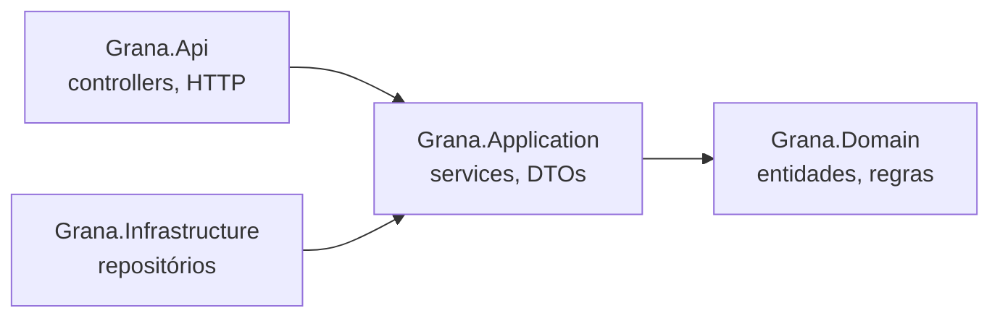

# Grana API

API REST para controle financeiro pessoal, feita com .NET 10. Ela cuida de contas, categorias, lançamentos, transferências, orçamento mensal e resumo do mês.

O objetivo do projeto é praticar regras de negócio bem feitas. Quem decide se algo é válido é o domínio. A API só devolve a resposta HTTP certa.

## Tecnologias

- C# e .NET 10 (ASP.NET Core)
- xUnit e Moq
- Entity Framework Core e PostgreSQL
- Docker
- JWT
- GitHub Actions
- Scalar / Swagger

---

## O que a API faz

- **Contas:** corrente, poupança ou carteira, com saldo inicial.
- **Categorias:** de receita ou de despesa, com orçamento mensal opcional.
- **Lançamentos:** entradas e saídas que atualizam o saldo da conta.
- **Transferências:** dinheiro de uma conta para outra.
- **Orçamento, resumo mensal e extrato:** quanto foi gasto, o saldo do mês e as movimentações de cada conta.

Alguns exemplos de regras:

- Uma despesa não pode deixar o saldo negativo.
- Só dá para desativar uma conta com saldo zero.
- Numa transferência, a saída e a entrada acontecem juntas. Se uma falhar, nenhuma é feita.
- Se mais de uma regra for quebrada, a API devolve todos os erros de uma vez.

```json
{
  "codigo": 400,
  "mensagem": "Não foi possível concluir a operação.",
  "erros": [
    "Saldo insuficiente na conta de origem.",
    "A conta de destino está desativada."
  ]
}
```

---

## Arquitetura

O projeto é dividido em camadas, e todas dependem do domínio, nunca o contrário.



- **Domain:** entidades e regras de negócio. Não depende de nada.
- **Application:** casos de uso. Busca os dados, chama o domínio e salva.
- **Infrastructure:** acesso aos dados com EF Core e PostgreSQL.
- **Api:** recebe a requisição e devolve a resposta HTTP. É a única camada que conhece HTTP.

---

## Decisões técnicas

- **Notification pattern em vez de exceções para validação.** Dado inválido é algo esperado, então as entidades guardam os erros e a API devolve todos juntos. Exceção fica só para o que é inesperado e vira erro 500.
- **`decimal` para dinheiro.** O `double` erra centavos (`0.1 + 0.2` não dá exatamente `0.3`).
- **Entidades protegidas.** O saldo só muda pelos métodos `Creditar` e `Debitar`, que aplicam as regras. Assim, uma conta nunca fica com dados inválidos.
- **DTOs na entrada e na saída.** A API não expõe as entidades do domínio.
- **Erros inesperados tratados em um lugar só**, com um `IExceptionHandler` que grava o detalhe no log.
- **Unit of Work para salvar.** Os services alteram as entidades e chamam `Salvar` uma vez no fim. Uma transferência grava as duas contas e o registro num único `SaveChanges`, então ou tudo é salvo ou nada é. Se o domínio devolver erro, nada é salvo.

---

## Como rodar

Precisa do [.NET SDK 10](https://dotnet.microsoft.com/download) e do [Docker](https://www.docker.com/) para subir o PostgreSQL.

```bash
git clone https://github.com/Vinicius-Souza-Rodrigues/grana-api.git
cd grana-api
```

### 1. Subir o banco

```bash
docker run --name grana-postgres -e POSTGRES_USER=grana -e POSTGRES_PASSWORD=grana -e POSTGRES_DB=grana -p 5432:5432 -d postgres:17
```

Depois disso, `docker start grana-postgres` liga o banco de novo e `docker stop grana-postgres` desliga.

### 2. Configurar a connection string

A connection string não fica no repositório. Em desenvolvimento ela vem do user-secrets:

```bash
dotnet user-secrets set "ConnectionStrings:Grana" "Host=localhost;Port=5432;Database=grana;Username=grana;Password=grana" --project src/Grana.Api
```

### 3. Criar as tabelas e rodar

```bash
dotnet tool restore
dotnet ef database update --project src/Grana.Infrastructure --startup-project src/Grana.Api
dotnet run --project src/Grana.Api
```

O `dotnet tool restore` instala o `dotnet-ef` na versão do projeto. As migrations ficam em `src/Grana.Infrastructure/Migrations`.

### Testes

```bash
dotnet test
```

Os testes usam o provider em memória do EF Core e não precisam do banco.

---

## Roadmap

- [x] Estrutura em camadas, Notification e tratamento de erros
- [x] Contas, categorias, lançamentos e transferências
- [x] Orçamento, resumo mensal e extrato
- [x] Banco de dados com EF Core e PostgreSQL
- [x] Docker, documentação com Scalar e CI com GitHub Actions
- [x] Autenticação com JWT

---

## Sobre o desenvolvimento


Se quiser ver como eu trabalho usando IA, com Agentes e Skills, dá uma olhada no projeto 

---

## Autor

Vinicius Souza Rodrigues

[GitHub](https://github.com/Vinicius-Souza-Rodrigues/grana-api.git) · [LinkedIn](https://www.linkedin.com/in/SEU-PERFIL)
