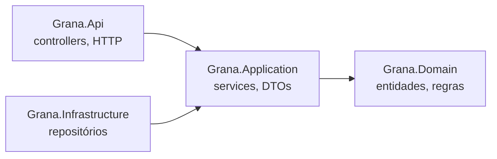

# Grana API

API REST para controle financeiro pessoal, feita com .NET 10. Ela cuida de contas, categorias, lançamentos, transferências, orçamento mensal e resumo do mês.

O objetivo do projeto é praticar regras de negócio bem feitas. Quem decide se algo é válido é o domínio. A API só devolve a resposta HTTP certa.

## Tecnologias

- C# e .NET 10 (ASP.NET Core)
- xUnit e Moq
- Entity Framework Core e PostgreSQL
- Docker
- JWT
- GitHub Actions
- Scalar / Swagger

---

## O que a API faz

- **Contas:** corrente, poupança ou carteira, com saldo inicial.
- **Categorias:** de receita ou de despesa, com orçamento mensal opcional.
- **Lançamentos:** entradas e saídas que atualizam o saldo da conta.
- **Transferências:** dinheiro de uma conta para outra.
- **Orçamento, resumo mensal e extrato:** quanto foi gasto, o saldo do mês e as movimentações de cada conta.

Alguns exemplos de regras:

- Uma despesa não pode deixar o saldo negativo.
- Só dá para desativar uma conta com saldo zero.
- Numa transferência, a saída e a entrada acontecem juntas. Se uma falhar, nenhuma é feita.
- Se mais de uma regra for quebrada, a API devolve todos os erros de uma vez.

```json
{
  "codigo": 400,
  "mensagem": "Não foi possível concluir a operação.",
  "erros": [
    "Saldo insuficiente na conta de origem.",
    "A conta de destino está desativada."
  ]
}
```

---

## Arquitetura

O projeto é dividido em camadas, e todas dependem do domínio, nunca o contrário.



- **Domain:** entidades e regras de negócio. Não depende de nada.
- **Application:** casos de uso. Busca os dados, chama o domínio e salva.
- **Infrastructure:** acesso aos dados.
- **Api:** recebe a requisição e devolve a resposta HTTP. É a única camada que conhece HTTP.

---

## Decisões técnicas

- **Notification pattern em vez de exceções para validação.** Dado inválido é algo esperado, então as entidades guardam os erros e a API devolve todos juntos. Exceção fica só para o que é inesperado e vira erro 500.
- **`decimal` para dinheiro.** O `double` erra centavos (`0.1 + 0.2` não dá exatamente `0.3`).
- **Entidades protegidas.** O saldo só muda pelos métodos `Creditar` e `Debitar`, que aplicam as regras. Assim, uma conta nunca fica com dados inválidos.
- **DTOs na entrada e na saída.** A API não expõe as entidades do domínio.
- **Erros inesperados tratados em um lugar só**, com um `IExceptionHandler` que grava o detalhe no log.

---

## Como rodar

Precisa do [.NET SDK 10](https://dotnet.microsoft.com/download).

```bash
git clone https://github.com/Vinicius-Souza-Rodrigues/grana-api.git
cd grana-api
dotnet run --project src/Grana.Api
dotnet test
```

---

## Roadmap

- [x] Estrutura em camadas, Notification e tratamento de erros
- [ ] Contas, categorias, lançamentos e transferências
- [ ] Orçamento, resumo mensal e extrato
- [ ] Banco de dados com EF Core e PostgreSQL
- [ ] Docker, documentação com Scalar e CI com GitHub Actions
- [ ] Autenticação com JWT

---

## Sobre o desenvolvimento

Fiz este projeto para mostrar como eu programo. Por isso, escrevi todo o código sozinho, sem usar Inteligência Artificial. O domínio, as regras de negócio, a arquitetura e os testes são decisões minhas.

O README também fui eu que escrevi. Usei IA só para revisar o texto: corrigir a ortografia, organizar o layout e melhorar algumas frases.

Se quiser ver como eu trabalho usando IA, com Agentes e Skills, dá uma olhada no projeto [NOME-DO-PROJETO](https://github.com/Vinicius-Souza-Rodrigues/NOME-DO-PROJETO).

---

## Autor

Vinicius Souza Rodrigues

[GitHub](https://github.com/Vinicius-Souza-Rodrigues/grana-api.git) · [LinkedIn](https://www.linkedin.com/in/SEU-PERFIL)
